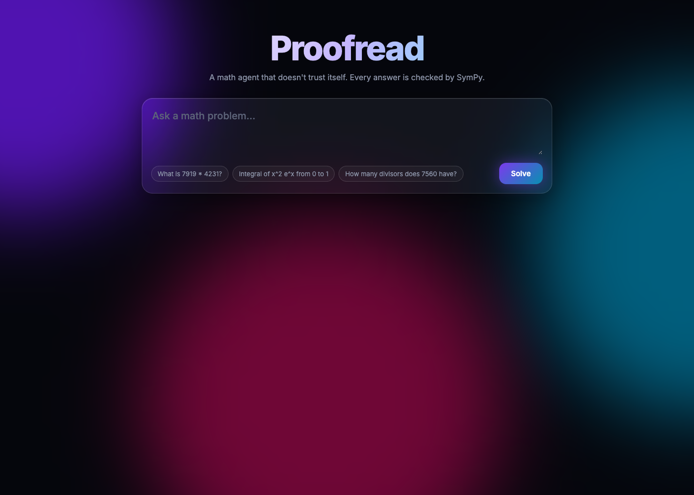
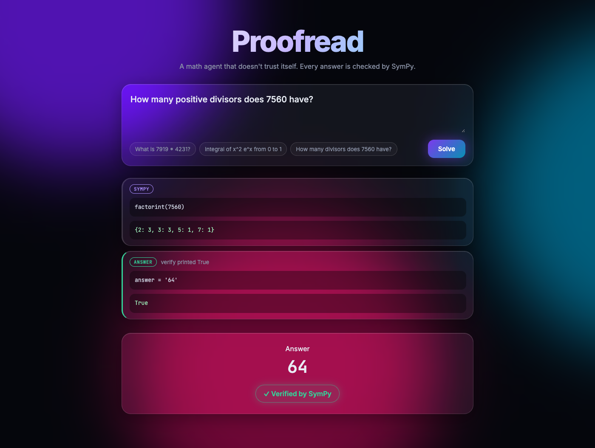
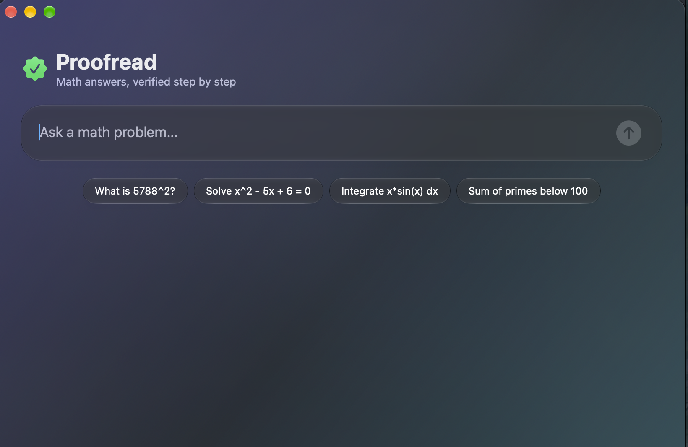

# Proofread — a math harness that won't accept unverified answers

Open-weight models are confidently wrong at math. Proofread is a small, open-source **model harness** (≈150 lines of Python) that wraps any OpenAI-compatible model — Ollama, vLLM, OpenRouter, Groq — and enforces one rule:

> **The model proposes. SymPy decides.** A final answer is only accepted if it ships with SymPy code that proves it. Otherwise the harness rejects it, feeds back the failure, and makes the model try again.

## What the harness manages

| Concern | How Proofread handles it | File |
|---|---|---|
| **Prompts** | System prompt forbids mental arithmetic; nudges the model back to tools if it answers in prose | `agent.py` |
| **Tools** | `sympy(code)` — sandboxed subprocess (`python -I`, 10s timeout) with SymPy preloaded · `check(a, b)` — symbolic equality · `recall(query)` — memory search · `plot(expr, a, b)` — matplotlib PNG, shown inline in the UI · `answer(answer, verify)` | `tools.py` |
| **Actions / verifier gate** | `answer` runs the model's own `verify` code. Accepted only if it prints `True`. Otherwise: `REJECTED: …` goes back into the loop | `agent.py` |
| **Memory** | Every *verified* answer is appended to `memory.jsonl`; the model can `recall` past results by keyword. Unverified answers never pollute memory | `memory.py` |
| **Context** | When the transcript exceeds a budget, old tool outputs are collapsed to one line, keeping system prompt, the problem and the last 6 turns intact | `agent.py: compact()` |
| **Loop breaking** | Small models re-run the same call forever (we watched Llama-3.1-8B print `7919*4231` twelve times). Repeated calls get a `LOOP:` warning, and the last 2 steps force `tool_choice=answer` | `agent.py: solve()` |
| **Open-model quirks** | Every one of these came from watching real open models fail: tool calls printed as JSON *text* (gpt-oss-20b) get parsed and run anyway (`text_call`). Arguments wrapped in `{"parameters": {...}}` (Llama-3.1-8B) get unwrapped (`unwrap`). Code with no `print()` gets REPL-style auto-printing of the last expression (`auto_print`). Malformed tool JSON goes back to the model as an error instead of crashing the loop | `agent.py`, `tools.py` |

```
            ┌────────────── REJECTED: verify printed False ─────────────┐
            ▼                                                           │
problem ─► model ──tool call──► sympy / check / recall ──result──► model ──answer+verify──► SymPy runs verify
                                                                                               │ True
                                                                                               ▼
                                                                           accept ─► memory.jsonl
```

## Example

```
$ python agent.py "Find the sum of all real x such that x^3 - 6x^2 + 11x - 6 = 0"
  sympy(solve(x**3-6*x**2+11*x-6)) → [1, 2, 3]  Sum: 6
  answer={"answer":"6","verify":"... sum(symbols) == 6 for symbols in ..."} → REJECTED: SyntaxError
  answer={"answer":"6","verify":"... sum(sol) == 6"}                       → REJECTED: (no output, use print)
  answer='6' verify→True
('6', True)
```

The gate caught two bogus "proofs" before accepting a real one.

## Results

| Model | Baseline (answer directly) | Proofread | Verified by SymPy | Avg time base / harness |
|---|---|---|---|---|
| `gpt-oss-20b` | 7/8 | **8/8** | 8/8 | 1s / 83s |
| `llama-3.1-8b` | 0/8 | **1/8** | 1/8 | 1s / 39s |
| `llama-3.3-70b` | 0/2 | **2/2** | 2/2 | 8s / 72s |

8 hard-for-mental-math problems (big products, roots, integrals, divisor counts, modular powers, Fibonacci, sums of squares, determinants); `bench.py`, graded symbolically. Rows are the problems finished before the hackathon deadline, run through free hosted endpoints of open-weight models.

- **Llama-3.3-70B goes from 0 correct to all correct.** Answering directly, it botches the arithmetic. Under Proofread, every answer is computed and SymPy-verified.
- **gpt-oss-20b** is already strong. The harness keeps it honest: every answer comes with a passing proof.
- **Llama-3.1-8B** shows the limit: it can compute the right value but never commits to an answer. That's what drove the loop-breaker and quirk normalizers above.
- The cost is latency: each answer takes several model calls.

## Run it

```bash
pip install -r requirements.txt
cd proofread

# local open model via Ollama
MODEL=qwen3.5:9b-mlx python agent.py "How many positive divisors does 7560 have?"

# any OpenAI-compatible endpoint
BASE_URL=https://openrouter.ai/api/v1 API_KEY=... MODEL=meta-llama/llama-3.1-8b-instruct python agent.py "..."

python bench.py        # baseline vs Proofread on the built-in problem set
python test_tools.py   # self-test for tools + memory
```

With no env vars it uses freellmapi at `http://localhost:3001/v1` (model `auto`, key from `FREELLMAPI_TOKEN`). Env vars: `MODEL`, `BASE_URL`, `API_KEY`.

### Web UI — watch the harness think

```bash
python proofread/server.py      # http://localhost:8765
```

`server.py` (stdlib only) streams every harness step over Server-Sent Events (`POST /solve`). A visual **math editor** (MathLive: ∫, d/dx, Σ, lim, √, fractions, matrices, virtual keyboard) lets you type integrals like you write them. The UI renders a live timeline: each tool call gets a badge, **rejected answers shake red**, and the accepted answer gets a glowing **✓ Verified by SymPy** seal. `GET /memory` feeds a **Verified memory** panel (click a row to re-ask). A sidebar keeps **multiple chats** in localStorage with New chat, Clear chat and Clear all; the mac app has Clear too. Live stats show elapsed time, step count and rejection count, and a copy-answer button sits on the result. Plots appear inline in the timeline.





### Native macOS app (Liquid Glass)

```bash
cd mac && ./run.sh              # needs macOS 26+, talks to server.py
```

SwiftUI app built on the macOS 26 Liquid Glass APIs (`glassEffect`, `GlassEffectContainer`). It streams the same SSE feed into an animated glass timeline.



## Limits

- Verification is only as good as the `verify` code the model writes; a model could write a trivially-true check. The gate catches crashes, wrong arithmetic and missing proofs, not adversarial ones.
- Memory recall is keyword overlap, not embeddings.
- The sandbox is a separate isolated Python process with a timeout, not a container — run untrusted models in a VM.

## License

MIT
